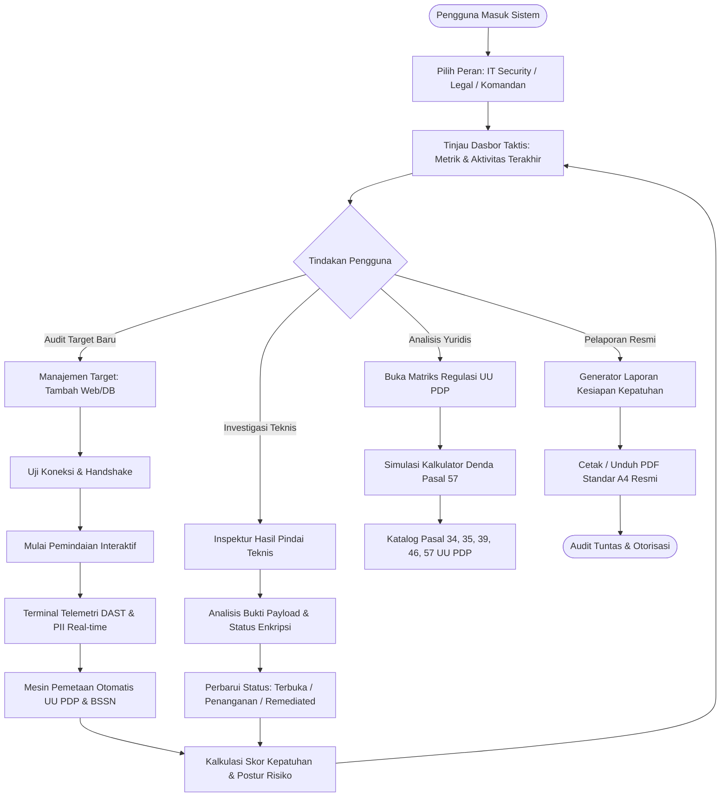
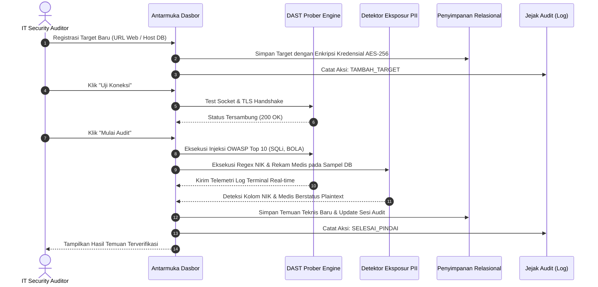
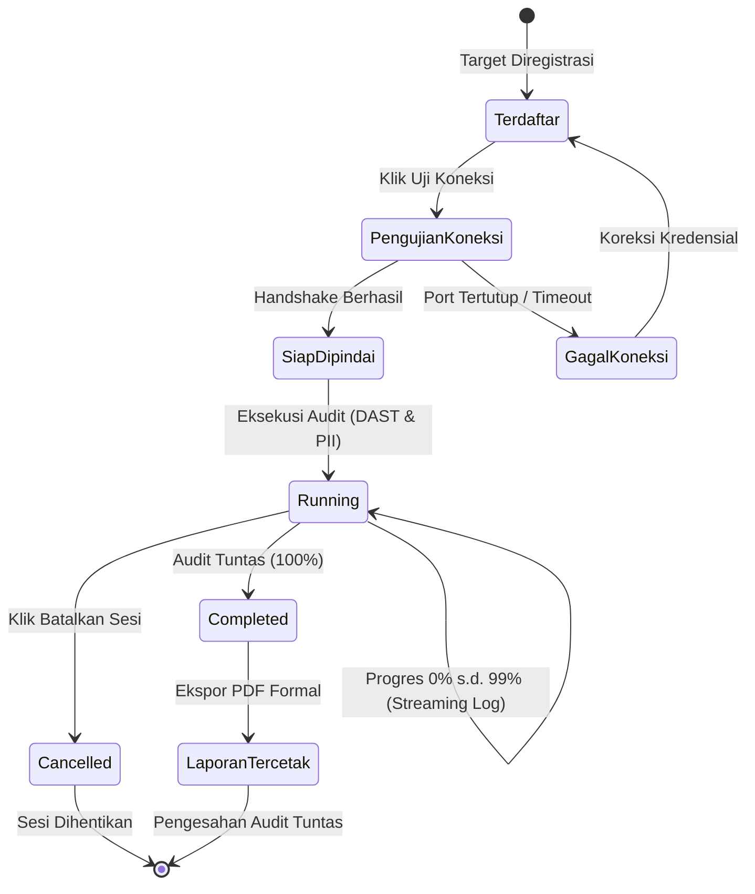
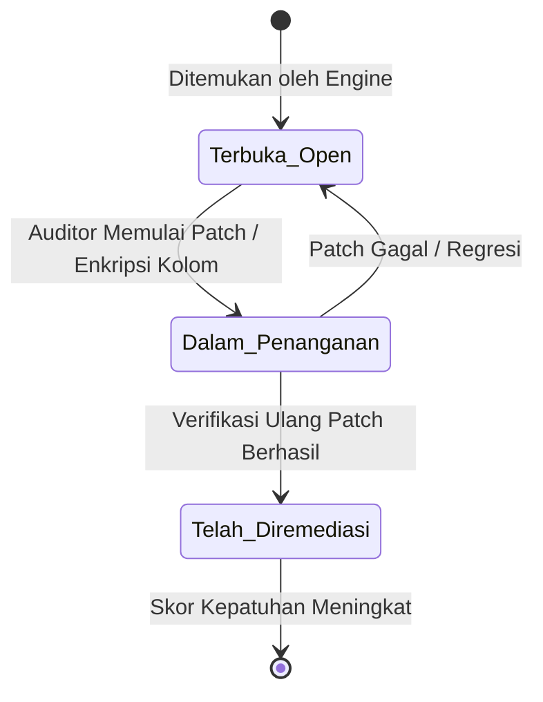

# AFD — App Flow Documentation (Dokumen Alur Aplikasi)
## KARTIKA: Kepatuhan Audit Risiko & Teknologi Informasi Keamanan Aplikasi
*(User Journeys, State Machine Diagrams & Interaction Sequences)*

---

### Informasi Dokumen / Document Information
* **ID Dokumen / Document ID**: `KARTIKA-DOC-AFD-01`
* **Versi / Version**: 1.0.0
* **Status**: Disetujui / Approved
* **Klasifikasi / Classification**: Terbatas / Restricted

---

## 1. Alur Perjalanan Pengguna Global / Global User Journey

Aplikasi KARTIKA dirancang dengan prinsip **Tactical Workflow**: informasi tingkat tinggi tersaji secara langsung di dasbor eksekutif, dan pengguna dapat melakukan investigasi mendalam (*drill-down*) ke bukti teknis payload atau pasal regulasi dalam 1 hingga 2 klik.

---

## 2. Alur Khusus Persona / Persona-Specific Workflows

### 2.1. Alur Kerja IT Security / Auditor Siber

### 2.2. Alur Kerja Compliance & Legal Officer
1. **Pemeriksaan Pelanggaran**: Legal Officer membuka dasbor untuk memeriksa metrik kepatuhan terkini dan memilih tab **Pemetaan Regulasi**.
2. **Korelasi Pasal UU PDP**:
   * Meninjau temuan *SQL Injection* $\rightarrow$ terhubung ke pelanggaran **Pasal 35 UU PDP** (Kewajiban Pengamanan Data).
   * Meninjau temuan *Kolom NIK / Rekam Medis Plaintext* $\rightarrow$ terhubung ke pelanggaran **Pasal 39 UU PDP** (Kewajiban Enkripsi Data Spesifik).
3. **Simulasi Plafon Denda (Pasal 57)**:
   * Menginput estimasi pendapatan tahunan instansi/korporasi (misal: Rp 50 Miliar).
   * Sistem menghitung ancaman denda administratif maksimal 2% (Rp 1 Miliar).
4. **Pemeriksaan Batas Waktu Insiden (Pasal 46)**:
   * Memastikan prosedur notifikasi 3x24 jam disiapkan jika status temuan tergolong *Data Breach Incident*.

### 2.3. Alur Kerja Komandan Satuan / C-Level
1. **Pemantauan Postur Risiko**: Membaca *Executive Summary Banner* dan kartu metrik kepatuhan (Status: *BERESIKO 42%*).
2. **Persetujuan Laporan Audit**: Mengakses menu **Generator Laporan**, memverifikasi kelengkapan bukti temuan teknis, analisis dampak hukum, serta matriks langkah remediasi prioritas.
3. **Otorisasi Cetak PDF**: Mengklik tombol **Cetak / Unduh PDF Resmi** untuk menghasilkan dokumen formal berklasifikasi *RAHASIA / TERBATAS* dengan tanda tangan pengesahan pimpinan.

---

## 3. Diagram Mesin Status / State Machine Diagrams

### 3.1. Siklus Hidup Sesi Audit (Audit Session Lifecycle)

### 3.2. Siklus Hidup Temuan Kerentanan (Vulnerability Remediation Lifecycle)

