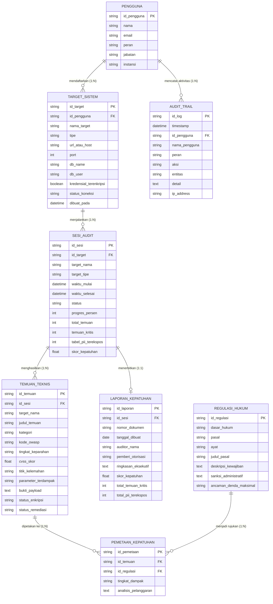

# BSD — Backend Schema Documentation (Dokumen Skema Basis Data)
## KARTIKA: Kepatuhan Audit Risiko & Teknologi Informasi Keamanan Aplikasi
*(Entity-Relationship Diagram, Relational Tables, Data Types & Security Integrity)*

---

### Informasi Dokumen / Document Information
* **ID Dokumen / Document ID**: `KARTIKA-DOC-BSD-01`
* **Versi / Version**: 1.0.0
* **Status**: Disetujui / Approved
* **Klasifikasi / Classification**: Terbatas / Restricted
* **Arsitektur Relasional**: 7 Entitas Inti ERD + 1 Entitas Jejak Audit Immutable

---

## 1. Desain Entity-Relationship Diagram (ERD)

Arsitektur basis data KARTIKA memisahkan **entitas operasional** (target, sesi audit, dan hasil pindai) dengan **referensi hukum statis** (undang-undang dan standar BSSN), yang dihubungkan melalui tabel relasional persimpangan (*junction table*) `Pemetaan_Kepatuhan` ($N:M$).

---

## 2. Rincian Kamus Data & Skema Tabel / Data Dictionary

### 2.1. Tabel `Pengguna` (User Accounts & Personas)
* **Deskripsi**: Menyimpan profil otentikasi dan hak akses untuk 3 persona utama (*IT Security, Legal Officer, Komandan Satuan*).

| Nama Kolom | Tipe Data | Batasan | Deskripsi |
| :--- | :--- | :--- | :--- |
| `id_pengguna` | `VARCHAR(32)` | **PRIMARY KEY** | Identifier unik pengguna (misal: `USR-001`). |
| `nama` | `VARCHAR(128)` | **NOT NULL** | Nama lengkap beserta gelar. |
| `email` | `VARCHAR(128)` | **NOT NULL, UNIQUE** | Alamat email dinas instansi. |
| `peran` | `ENUM` | **NOT NULL** | Nilai yang diizinkan: `'security'`, `'legal'`, `'commander'`, `'admin'`. |
| `jabatan` | `VARCHAR(128)` | **NOT NULL** | Nama jabatan struktural atau fungsional. |
| `instansi` | `VARCHAR(128)` | **NOT NULL** | Unit kerja/satuan pertahanan/kementerian. |

---

### 2.2. Tabel `Target_Sistem` (Target Systems Management)
* **Deskripsi**: Mencatat URL Web (DAST) atau koneksi Database yang diuji secara aman dengan enkripsi kredensial AES-256.

| Nama Kolom | Tipe Data | Batasan | Deskripsi |
| :--- | :--- | :--- | :--- |
| `id_target` | `VARCHAR(32)` | **PRIMARY KEY** | Identifier unik target (misal: `TGT-001`). |
| `id_pengguna` | `VARCHAR(32)` | **FOREIGN KEY (`Pengguna`)** | ID pengguna pendaftar aset. |
| `nama_target` | `VARCHAR(128)` | **NOT NULL** | Nama alias sistem target (misal: `E-Gov Portal`). |
| `tipe` | `ENUM` | **NOT NULL** | Nilai: `'web'`, `'database'`. |
| `url_atau_host` | `VARCHAR(255)` | **NOT NULL** | URL web (HTTPS) atau alamat IP database. |
| `port` | `INTEGER` | **DEFAULT (443/5432)** | Port jaringan layanan. |
| `db_name` | `VARCHAR(64)` | **NULLABLE** | Nama basis data target (jika tipe database). |
| `db_user` | `VARCHAR(64)` | **NULLABLE** | Nama user database akses audit (*read-only*). |
| `db_engine` | `VARCHAR(32)` | **NULLABLE** | Engine: `'mysql'`, `'postgresql'`. |
| `kredensial_terenkripsi`| `BOOLEAN` | **DEFAULT TRUE** | Status perlindungan enkripsi AES-256 kredensial. |
| `status_koneksi` | `VARCHAR(32)` | **NOT NULL** | Status uji: `'Tersambung'`, `'Gagal'`, `'Belum Diuji'`. |
| `dibuat_pada` | `DATE` | **NOT NULL** | Tanggal registrasi target. |

---

### 2.3. Tabel `Sesi_Audit` (Audit Sessions & Progress)
* **Deskripsi**: Merekam waktu mulai, selesai, progres, dan status tugas pemindaian.

| Nama Kolom | Tipe Data | Batasan | Deskripsi |
| :--- | :--- | :--- | :--- |
| `id_sesi` | `VARCHAR(32)` | **PRIMARY KEY** | Identifier sesi audit (misal: `SES-001`). |
| `id_target` | `VARCHAR(32)` | **FOREIGN KEY (`Target_Sistem`)** | Target sistem yang sedang diuji. |
| `waktu_mulai` | `VARCHAR(64)` | **NOT NULL** | Waktu inisiasi pengujian audit. |
| `waktu_selesai` | `VARCHAR(64)` | **NULLABLE** | Waktu penyelesaian pemindaian. |
| `status` | `ENUM` | **NOT NULL** | Nilai: `'Completed'`, `'Running'`, `'Cancelled'`, `'Pending'`. |
| `progres_persen`| `INTEGER` | **CHECK (0-100)** | Persentase progres eksekusi (0 s.d. 100%). |
| `total_temuan` | `INTEGER` | **DEFAULT 0** | Akumulasi total kerentanan teknis. |
| `temuan_kritis` | `INTEGER` | **DEFAULT 0** | Jumlah temuan berstatus Kritis. |
| `tabel_pii_terekspos` | `INTEGER` | **DEFAULT 0** | Jumlah tabel basis data yang mengekspos PII. |
| `skor_kepatuhan`| `FLOAT` | **CHECK (0-100)** | Nilai indeks kepatuhan hukum yang dihitung dinamis. |
| `kategori_risiko`| `ENUM` | **NOT NULL** | Nilai: `'Beresiko'`, `'Waspada'`, `'Patuh'`. |

---

### 2.4. Tabel `Temuan_Teknis` (Technical Vulnerabilities & PII Findings)
* **Deskripsi**: Menyimpan rincian kerentanan OWASP Top 10 dan eksposur data pribadi tanpa enkripsi beserta bukti teknis payload.

| Nama Kolom | Tipe Data | Batasan | Deskripsi |
| :--- | :--- | :--- | :--- |
| `id_temuan` | `VARCHAR(32)` | **PRIMARY KEY** | Identifier temuan (misal: `TMN-001`). |
| `id_sesi` | `VARCHAR(32)` | **FOREIGN KEY (`Sesi_Audit`)** | Sesi audit asal temuan. |
| `judul_temuan` | `VARCHAR(255)` | **NOT NULL** | Judul deskriptif temuan kerentanan. |
| `kategori` | `ENUM` | **NOT NULL** | Nilai: `'OWASP'`, `'PII'`. |
| `kode_owasp` | `VARCHAR(64)` | **NULLABLE** | Klasifikasi OWASP (misal: `A03:2021-Injection`). |
| `tingkat_keparahan`| `ENUM` | **NOT NULL** | Nilai: `'Kritis'`, `'Tinggi'`, `'Sedang'`, `'Rendah'`. |
| `cvss_skor` | `FLOAT` | **CHECK (0.0-10.0)** | Skor CVSS v3.1 numerik. |
| `titik_kelemahan`| `VARCHAR(255)` | **NOT NULL** | Endpoint URL atau nama tabel database. |
| `parameter_terdampak`| `VARCHAR(255)` | **NULLABLE** | Nama parameter HTTP atau kolom tabel. |
| `bukti_payload`| `TEXT` | **NOT NULL** | Bukti rekaman request/response HTTP atau dump DB. |
| `status_enkripsi`| `ENUM` | **NOT NULL** | Nilai: `'Plaintext (Terekspos)'`, `'Terenkripsi AES-256'`, `'Hashed Argon2'`, `'Tidak Tersedia (N/A)'`. |
| `status_remediasi`| `ENUM` | **NOT NULL** | Nilai: `'Terbuka (Open)'`, `'Dalam Penanganan'`, `'Telah Diremediasi'`. |
| `langkah_remediasi`| `TEXT` | **NOT NULL** | Panduan teknis langkah perbaikan untuk tim developer. |

---

### 2.5. Tabel `Regulasi_Hukum` (Statutory Reference Catalog)
* **Deskripsi**: Katalog referensi statis pasal-pasal kewajiban UU PDP No. 27/2022 dan regulasi teknis BSSN.

| Nama Kolom | Tipe Data | Batasan | Deskripsi |
| :--- | :--- | :--- | :--- |
| `id_regulasi` | `VARCHAR(32)` | **PRIMARY KEY** | Identifier regulasi (misal: `REG-001`). |
| `dasar_hukum` | `VARCHAR(64)` | **NOT NULL** | Contoh: `'UU PDP No. 27/2022'`, `'Pedoman BSSN'`. |
| `pasal` | `VARCHAR(64)` | **NOT NULL** | Nomor pasal (misal: `'Pasal 35'`). |
| `ayat` | `VARCHAR(64)` | **NULLABLE** | Ayat pasal (misal: `'Ayat (1) & (2)'`). |
| `judul_pasal` | `VARCHAR(255)` | **NOT NULL** | Judul intisari pasal hukum. |
| `deskripsi_kewajiban`| `TEXT` | **NOT NULL** | Uraian kewajiban hukum pengendali data. |
| `sanksi_administratif`| `TEXT` | **NOT NULL** | Deskripsi sanksi administratif formal. |
| `ancaman_denda_maksimal`| `VARCHAR(128)` | **NULLABLE** | Plafon denda administratif (misal: `Maks 2% pendapatan`). |

---

### 2.6. Tabel `Pemetaan_Kepatuhan` (Compliance Junction Table $N:M$)
* **Deskripsi**: Tabel relasional persimpangan (*junction table*) yang menghubungkan temuan kerentanan teknis ke pasal regulasi hukum tertentu.

| Nama Kolom | Tipe Data | Batasan | Deskripsi |
| :--- | :--- | :--- | :--- |
| `id_pemetaan` | `VARCHAR(32)` | **PRIMARY KEY** | Identifier unik relasi pemetaan. |
| `id_temuan` | `VARCHAR(32)` | **FOREIGN KEY (`Temuan_Teknis`)** | Relasi ke temuan kerentanan teknis spesifik. |
| `id_regulasi` | `VARCHAR(32)` | **FOREIGN KEY (`Regulasi_Hukum`)** | Relasi ke pasal hukum yang dilanggar. |
| `tingkat_dampak`| `ENUM` | **NOT NULL** | Nilai: `'Kritis'`, `'Tinggi'`, `'Sedang'`. |
| `analisis_pelanggaran`| `TEXT` | **NOT NULL** | Argumentasi hukum mengapa temuan teknis melanggar pasal terkait. |

---

### 2.7. Tabel `Laporan_Kepatuhan` (Compliance Reports Archive)
* **Deskripsi**: Menyimpan rekam jejak metadata dokumen resmi PDF yang diterbitkan oleh sistem.

| Nama Kolom | Tipe Data | Batasan | Deskripsi |
| :--- | :--- | :--- | :--- |
| `id_laporan` | `VARCHAR(32)` | **PRIMARY KEY** | Identifier laporan (misal: `REP-2026-X-0014`). |
| `id_sesi` | `VARCHAR(32)` | **FOREIGN KEY (`Sesi_Audit`)** | Sesi audit rujukan dokumen. |
| `nomor_dokumen`| `VARCHAR(64)` | **NOT NULL, UNIQUE** | Nomor registrasi formal dokumen instansi. |
| `tanggal_dibuat`| `DATE` | **NOT NULL** | Tanggal penetapan dokumen. |
| `auditor_nama` | `VARCHAR(128)` | **NOT NULL** | Nama personel auditor pelaksana. |
| `pemberi_otorisasi`| `VARCHAR(128)` | **NOT NULL** | Nama pejabat/komandan pengesah. |
| `ringkasan_eksekutif`| `TEXT` | **NOT NULL** | Narasi resmi ringkasan postur risiko. |
| `skor_kepatuhan`| `FLOAT` | **NOT NULL** | Nilai skor saat dokumen dicetak. |

---

### 2.8. Tabel `Audit_Trail` (Immutable Activity Logs)
* **Deskripsi**: Pencatatan log aktivitas pengguna yang komprehensif, berurutan waktu (*append-only*), dan tidak dapat dimanipulasi (*tamper-proof*).

| Nama Kolom | Tipe Data | Batasan | Deskripsi |
| :--- | :--- | :--- | :--- |
| `id_log` | `VARCHAR(32)` | **PRIMARY KEY** | Identifier log (misal: `LOG-901`). |
| `timestamp` | `VARCHAR(64)` | **NOT NULL** | Waktu kejadian berstandar WIB / ISO-8601. |
| `id_pengguna` | `VARCHAR(32)` | **NOT NULL** | ID akun pengguna pelaksana aksi. |
| `nama_pengguna`| `VARCHAR(128)` | **NOT NULL** | Nama lengkap pengguna. |
| `peran` | `VARCHAR(32)` | **NOT NULL** | Peran saat aksi dieksekusi (`security`, `legal`, `commander`). |
| `aksi` | `VARCHAR(64)` | **NOT NULL** | Kode aksi (`EKSEKUSI_PINDAI`, `TAMBAH_TARGET`, `AKSES_LAPORAN`). |
| `entitas` | `VARCHAR(128)` | **NOT NULL** | Sasaran objek yang diinteraksi. |
| `detail` | `TEXT` | **NOT NULL** | Deskripsi lengkap rincian aktivitas. |
| `ip_address` | `VARCHAR(45)` | **NOT NULL** | Alamat IP jaringan asal pengguna. |
