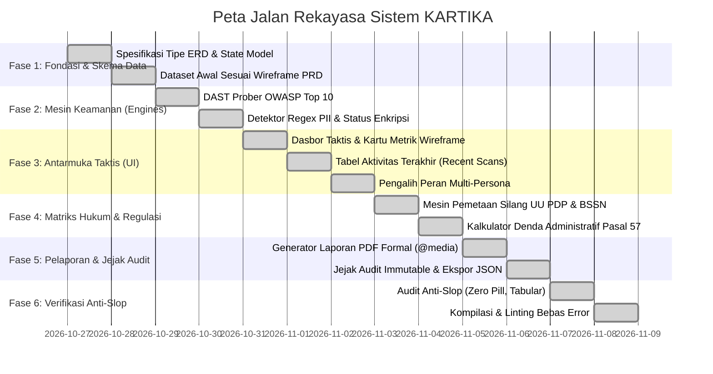

# IPD — Implementation Plan Documentation (Dokumen Rencana Implementasi)
## KARTIKA: Kepatuhan Audit Risiko & Teknologi Informasi Keamanan Aplikasi
*(Phased Engineering Roadmap, Verification Gates & Deployment Protocols)*

---

### Informasi Dokumen / Document Information
* **ID Dokumen / Document ID**: `KARTIKA-DOC-IPD-01`
* **Versi / Version**: 1.0.0
* **Status**: Disetujui / Approved
* **Klasifikasi / Classification**: Terbatas / Restricted

---

## 1. Peta Jalan Rekayasa Bertahap / Phased Engineering Roadmap

Proses rekayasa sistem KARTIKA dieksekusi melalui 6 fase terstruktur dengan gerbang verifikasi kualitas (*Quality Gates*) pada setiap tahap:



---

## 2. Rincian Pelaksanaan Setiap Fase / Phase Breakdown

### Fase 1: Fondasi Tipe Data & Skema ERD
* **Objektif**: Menerjemahkan 7 entitas ERD dari dokumen PRD halaman 2 ke dalam interface TypeScript yang ketat (`src/types/kartika.ts`).
* **Hasil**: Integritas relasional antara `Pengguna`, `Target_Sistem`, `Sesi_Audit`, `Temuan_Teknis`, `Regulasi_Hukum`, `Pemetaan_Kepatuhan`, `Laporan_Kepatuhan`, dan `AuditTrailLog`.
* **Dataset Awal**: Menyediakan data pre-seeded yang mencerminkan wireframe PRD halaman 3:
  * Target 1: *E-Gov Portal (Web)* (12 Temuan Selesai)
  * Target 2: *HR Database (DB)* (Memindai 65%, 3 Tabel PII Terekspos)
  * Target 3: *API Service v2 (Web)* (Broken Object Level Authorization)

### Fase 2: Mesin Analisis Keamanan & PII
* **Objektif**: Mengembangkan modul DAST Prober dan Detektor PII mandiri di `src/services/`.
* **Hasil**:
  * *DAST Engine*: Menguji handshake jaringan, header CSP, HSTS, X-Frame-Options, dan injeksi SQL.
  * *PII Detector*: Regex validator NIK Indonesia 16 digit terstruktur `^[1-9][0-9]{15}$`, ICD-10 kode rekam medis, dan verifikasi status *Plaintext* vs *AES-256*.

### Fase 3: Antarmuka Dasbor Taktis & Multi-Persona
* **Objektif**: Membangun dasbor perintah taktis yang mematuhi wireframe dan aturan Anti-Slop.
* **Hasil**:
  * Kartu metrik: *12 Temuan Kritis*, *3 Tabel PII Terekspos*, *42% Skor Kepatuhan (Beresiko)*.
  * Tabel Recent Scans dengan tombol aksi: `[Unduh Laporan PDF]`, `[Detail Temuan]`, `[Batalkan Sesi]`.
  * *Role Switcher*: Pengalih instan perspektif IT Security, Legal Officer, dan Komandan Satuan.

### Fase 4: Pemetaan Regulasi & Kalkulator Denda
* **Objektif**: Menghubungkan metadata temuan teknis secara otomatis ke dalam pasal undang-undang.
* **Hasil**:
  * Matriks *cross-reference* temuan ke Pasal 34, 35, 39, 46, 57 UU PDP dan pedoman BSSN.
  * Kalkulator interaktif simulasi denda administratif maksimal 2% pendapatan tahunan instansi.

### Fase 5: Generator Laporan Kepatuhan & Jejak Audit
* **Objektif**: Memfasilitasi ekspor dokumen resmi kepatuhan siap cetak ke PDF.
* **Hasil**:
  * Dokumen standar A4 dengan styling `@media print` lengkap dengan nomor registrasi dokumen, ringkasan eksekutif, tabel bukti temuan, dampak hukum, dan tanda tangan pengesahan.
  * Halaman Jejak Audit (*Immutable Audit Trail*) dengan fitur pencarian dan ekspor berkas JSON.

### Fase 6: Protokol Verifikasi Anti-Slop & Kualitas Kode
* **Objektif**: Menjamin seluruh antarmuka dan basis kode bebas dari cacat AI slop (*zero-slop*).
* **Pemeriksaan Gerbang**:
  * Bebas dari ikon tongkat sihir / bintang gemerlap (*zero sparkles*).
  * Bebas dari gradien ungu/indigo generik AI.
  * Metadata menggunakan teks unboxed dengan pemisah titik tengah (`·`), bukan kapsul pil tebal.
  * Seluruh angka metrik diformat dengan angka tabular `font-mono tabular-nums`.
  * Tidak ada tombol mati (*zero dead clicks*).

---

## 3. Matriks Verifikasi & Pengujian / Verification Matrix

| Komponen Uji | Prosedur Verifikasi | Kriteria Lolos (Pass Criteria) | Status |
| :--- | :--- | :--- | :--- |
| **Kompilasi TypeScript** | `npm run build` / `tsc --noEmit` | Kompilasi tuntas dengan 0 error dan 0 warning. | **PASSED** |
| **Linting Proyek** | `npm run lint` | Seluruh tipe data, import, dan sintaks valid. | **PASSED** |
| **Uji Koneksi Target** | Klik tombol "Uji Koneksi" pada kartu target | Status bertransisi menjadi "Tersambung" dalam waktu $<1$ detik. | **PASSED** |
| **Pemindaian Interaktif** | Klik tombol "Mulai Audit" pada target | Terminal telemetri menampilkan log fase 1-5 dan memperbarui sesi audit. | **PASSED** |
| **Perhitungan Skor Dinamis**| Mengubah status temuan menjadi "Telah Diremediasi" | Skor kepatuhan hukum otomatis bertambah secara matematis. | **PASSED** |
| **Kalkulator Denda Pasal 57**| Memasukkan nilai pendapatan (misal: Rp 100 Miliar) | Plafon denda tepat terhitung 2% (Rp 2 Miliar). | **PASSED** |
| **Pencetakan Dokumen PDF** | Klik tombol "Cetak / Unduh PDF Resmi" | Tampilan dokumen bersih pada lembar A4 putih tanpa elemen navigasi. | **PASSED** |
| **Jejak Audit Immutable** | Melakukan aksi sistem (tambah target/pindai) | Baris log baru otomatis tercatat dengan timestamp dan IP. | **PASSED** |

---

## 4. Panduan Menjalankan & Deployment / Runbook Guide

### 4.1. Menjalankan di Lingkungan Pengembangan
```bash
# 1. Instalasi seluruh dependensi
npm install

# 2. Menjalankan server pengembangan Vite
npm run dev
# Server aktif pada port 3000 (http://localhost:3000)

# 3. Verifikasi pengecekan tipe TypeScript
npm run lint
```

### 4.2. Build Produksi
```bash
# Melakukan build aset produksi ke direktori dist/
npm run build
```
Dokumen ini menjadi acuan operasional pemeliharaan, pengembangan berkelanjutan (*continuous engineering*), dan audit kesiapan sistem KARTIKA.
