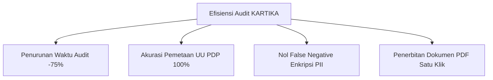

# PRD — Product Requirement Documentation (Dokumen Kebutuhan Produk)
## KARTIKA: Kepatuhan Audit Risiko & Teknologi Informasi Keamanan Aplikasi
*(Application Security, Risk Audit & Regulatory Compliance Automated System)*

---

### Informasi Dokumen / Document Information
* **ID Dokumen / Document ID**: `KARTIKA-DOC-PRD-01`
* **Versi / Version**: 1.0.0
* **Status**: Disetujui / Approved
* **Klasifikasi / Classification**: Terbatas / Restricted
* **Kerangka Regulasi / Regulatory Framework**: UU No. 27 Tahun 2022 tentang Pelindungan Data Pribadi (UU PDP) & Standar Keamanan Sistem Pemerintahan Berbasis Elektronik (SPBE) BSSN

---

## 1. Ringkasan Eksekutif / Executive Summary

### Bahasa Indonesia
KARTIKA adalah perangkat bantu audit otomatis yang beroperasi di irisan antara keamanan siber operasional (*operational cybersecurity*) dan kepatuhan hukum (*regulatory compliance*). Sistem ini memecahkan masalah inefisiensi dan komunikasi yang terisolasi (*silo*) antara tim **IT Security / Auditor Siber** dan tim **Legal / Compliance Officer**. 

KARTIKA bekerja dengan memindai kerentanan teknis (berbasis standar OWASP Top 10) serta eksposur Data Pribadi Umum dan Spesifik (PII), lalu secara otomatis dan instan menerjemahkan temuan teknis tersebut ke dalam bahasa hukum formal (pasal-pasal kewajiban UU PDP dan pedoman BSSN) melalui dokumen resmi *Compliance Readiness Report*.

### English
KARTIKA is an automated audit tooling system operating at the intersection of operational cybersecurity and regulatory compliance. It bridges the critical operational silo and communication divide between IT Security engineering teams and Legal/Compliance Officers.

The platform executes dynamic technical vulnerability scans (based on OWASP Top 10) and personal data exposure detection (General & Specific PII), instantly cross-referencing technical flaws into enforceable legal articles (Indonesian Personal Data Protection Act / UU PDP and National Cyber and Crypto Agency / BSSN guidelines) via formal *Compliance Readiness Reports*.

---

## 2. Sasaran Pengguna & Persona / User Personas

```
┌─────────────────────────────────────────────────────────────────────────────┐
│                          KARTIKA USER PERSONAS                              │
├──────────────────────────┬──────────────────────────┬───────────────────────┤
│ 1. IT SECURITY AUDITOR   │ 2. COMPLIANCE & LEGAL    │ 3. C-LEVEL / KOMANDAN │
│ - Cek kerentanan OWASP   │ - Pemetaan pasal UU PDP  │ - Skor postur risiko  │
│ - Request/response dump  │ - Ancaman denda Pasal 57 │ - Ringkasan eksekutif │
│ - Verifikasi enkripsi    │ - Notifikasi 3x24h (P.46)│ - Keputusan anggaran  │
└──────────────────────────┴──────────────────────────┴───────────────────────┘
```

### 2.1. IT Security / Auditor Siber (Cyber Security Auditor)
* **Karakteristik / Characteristics**: Praktisi teknis keamanan siber berlisensi (misal: CEH, OSCP, CISSP).
* **Kebutuhan / Needs**: Alat otomatis untuk memindai aplikasi web dan basis data tanpa harus menulis skrip uji penetrasi berulang kali.
* **Perilaku Kunci / Key Actions**: Mendaftarkan URL target web dan host database, menjalankan DAST fuzzing, menganalisis status enkripsi (Plaintext vs AES-256), serta menindaklanjuti status remediasi teknis.

### 2.2. Compliance & Legal Officer (Petugas Hukum & Kepatuhan)
* **Karakteristik / Characteristics**: Ahli hukum perusahaan atau instansi pemerintah berlatar belakang hukum perdata/pidana siber.
* **Kebutuhan / Needs**: Dasbor yang menerjemahkan istilah teknis (seperti *SQL Injection* atau *Broken Object Level Authorization*) ke dalam risiko pelanggaran pasal hukum spesifik.
* **Perilaku Kunci / Key Actions**: Menghitung potensi denda administratif maksimal (UU PDP Pasal 57 hingga 2% pendapatan tahunan), memantau kewajiban pelaporan insiden kebocoran data dalam batas waktu $3 \times 24$ jam (UU PDP Pasal 46).

### 2.3. Komandan Satuan / C-Level (Executive Commander & CISO)
* **Karakteristik / Characteristics**: Pimpinan pengambil kebijakan strategis instansi pertahanan, kementerian, atau korporasi.
* **Kebutuhan / Needs**: Laporan ringkas (*Executive Summary*) yang menunjukkan postur keamanan siber instansi, tingkat kesiapan operasional (*readiness score*), dan prioritas alokasi anggaran remediasi.
* **Perilaku Kunci / Key Actions**: Menandatangani dokumen pengesahan audit, mengevaluasi status risiko instansi (*Beresiko*, *Waspada*, *Patuh*).

---

## 3. Kebutuhan Fungsional / Functional Requirements

| ID Kebutuhan | Nama Fitur | Deskripsi Fungsional (Bahasa Indonesia & English) |
| :--- | :--- | :--- |
| **FR-01** | **Manajemen Target Audit**<br>*(Target Systems Management)* | Registrasi URL aplikasi web publik/internal dan kredensial koneksi basis data (MySQL, PostgreSQL). Seluruh data *connection string* dan kredensial dienkripsi menggunakan standar AES-256.<br>*Secure registration of web application URLs and database credentials with AES-256 encryption.* |
| **FR-02** | **Pemindai Kerentanan (DAST Engine)**<br>*(Dynamic Application Security Testing)* | Modul pemindaian dinamis untuk mendeteksi celah keamanan OWASP Top 10 (SQL Injection, Broken Access Control, XSS, Security Misconfigurations, HSTS/CSP missing headers).<br>*DAST engine identifying OWASP Top 10 vulnerabilities via network and payload fuzzing.* |
| **FR-03** | **Detektor Eksposur PII**<br>*(PII Exposure Detector)* | Modul inspeksi skema dan sampel data basis data untuk mendeteksi entitas PII Indonesia (NIK 16 digit terstruktur, Nama Lengkap, Rekam Medis/ICD-10, Nomor Rekening Bank) dan memverifikasi status enkripsi (*Plaintext* vs *AES-256* vs *Argon2*).<br>*Database inspection engine detecting Indonesian PII entities and verifying column-level encryption states.* |
| **FR-04** | **Mesin Pemetaan Regulasi**<br>*(Regulatory Cross-Reference Engine)* | Algoritma penautan otomatis antara ID temuan kerentanan teknis dengan pasal-pasal kewajiban UU PDP No. 27/2022 (Pasal 34, 35, 39, 46, 57, 65, 67) dan standar pedoman BSSN.<br>*Automated inference engine mapping technical vulnerability IDs to statutory legal articles and penalty provisions.* |
| **FR-05** | **Kalkulator Denda Administratif**<br>*(Statutory Fine Calculator)* | Fitur simulasi perhitungan eksposur denda finansial maksimal berdasarkan Pasal 57 Ayat (2) UU PDP (hingga 2% dari total pendapatan/penerimaan tahunan pengendali data).<br>*Interactive calculator simulating maximum financial fine liabilities under Article 57 UU PDP.* |
| **FR-06** | **Generator Laporan Kepatuhan**<br>*(Compliance Report Generator)* | Generator dokumen formal standar A4 siap cetak dan ekspor PDF instan yang memuat Ringkasan Eksekutif, Bukti Payload Teknis, Dampak Yuridis, dan Rencana Remediasi Terjadwal.<br>*Instant formal PDF export engine generating executive summaries, technical proofs, legal impacts, and roadmaps.* |
| **FR-07** | **Multi-Persona Role Switcher**<br>*(Role Perspective Switcher)* | Pengalih antarmuka dinamis antara 3 perspektif persona (IT Security, Legal Officer, Komandan Satuan) dengan visibilitas data yang disesuaikan.<br>*Dynamic UI role switcher catering views for IT Auditors, Legal Officers, and C-Level Commanders.* |

---

## 4. Kebutuhan Non-Fungsional / Non-Functional Requirements

### 4.1. Keamanan Kredensial & Data / Security & Privacy
* **NFR-SEC-01 (Kredensial Terenkripsi)**: Seluruh data koneksi target (*connection strings*) disimpan menggunakan standar enkripsi simetris AES-256.
* **NFR-SEC-02 (Jejak Audit Immutable)**: Seluruh aktivitas pengguna (login, uji koneksi, eksekusi pemindaian, perubahan status remediasi, ekspor laporan) dicatat dalam log jejak audit yang tidak dapat dihapus atau dimanipulasi (*tamper-proof audit trail*).

### 4.2. Performa & Waktu Tanggap / Performance & Latency
* **NFR-PERF-01**: Interaksi antarmuka pengguna, pemfilteran tabel, dan peralihan persona wajib merespons dalam waktu $\le 200\text{ms}$.
* **NFR-PERF-02**: Pemindaian skala menengah (hingga 500 endpoint atau 5GB data basis data) ditargetkan tuntas dalam waktu maksimal 3 jam operasional dengan telemetri progres *real-time*.

### 4.3. Aksesibilitas & Kepatuhan Desain / Design & Accessibility
* **NFR-ACC-01**: Memenuhi standar kontras visual WCAG AA (rasio kontras $\ge 4.5:1$).
* **NFR-ACC-02**: Penerapan konstitusi *miqdadbadjuber/Anti-Slop*: bebas dari ornamen generik kecerdasan buatan (*zero sparkles, zero purple gradients, zero pill badge sandwiches, tabular-nums for metrics*).

---

## 5. Metrik Keberhasilan Produk / Success Metrics



1. **Reduksi Waktu Audit**: Mengurangi durasi siklus audit dari hitungan minggu menjadi beberapa jam.
2. **Eliminasi Silo Komunikasi**: Meningkatkan pemahaman bersama antara tim teknis dan tim hukum instansi dengan pemetaan otomatis 100% temuan ke pasal regulasi.
3. **Kesiapan Regulasi (Readiness Posture)**: Memastikan instansi terhindar dari sanksi administratif Pasal 57 dan mematuhi batas waktu notifikasi 3x24 jam Pasal 46 UU PDP.
