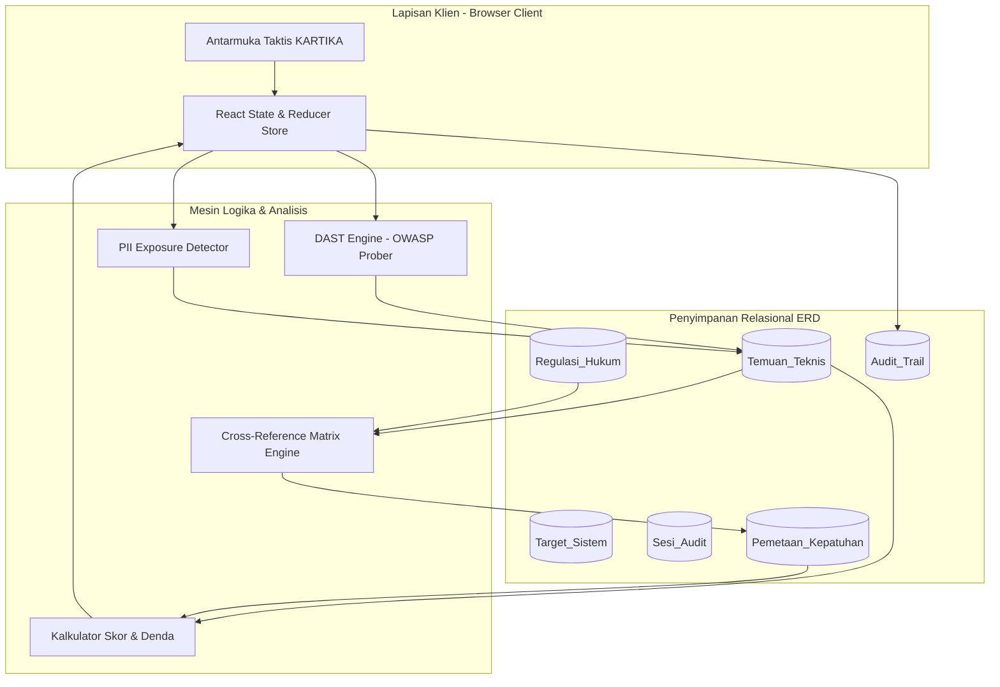

# TRD — Technical Requirement Documentation (Dokumen Kebutuhan Teknis)
## KARTIKA: Kepatuhan Audit Risiko & Teknologi Informasi Keamanan Aplikasi
*(Technical Architecture, Engine Pipeline & Security Specifications)*

---

### Informasi Dokumen / Document Information
* **ID Dokumen / Document ID**: `KARTIKA-DOC-TRD-01`
* **Versi / Version**: 1.0.0
* **Status**: Disetujui / Approved
* **Klasifikasi / Classification**: Terbatas / Restricted
* **Lingkungan Eksekusi / Execution Environment**: Node.js 22 LTS, React 19, TypeScript 5+, Vite 6+

---

## 1. Arsitektur Teknis Sistem / System Technical Architecture

KARTIKA mengadopsi arsitektur **Hybrid Scanning Pipeline** yang memisahkan lapisan visual taktis (*Tactical Presentation Layer*), lapisan orkestrasi logika (*Application Logic & State Management*), dan lapisan mesin pemindaian keamanan (*Security Inspection & Inference Engines*).

```
┌─────────────────────────────────────────────────────────────────────────────┐
│                       KARTIKA TECHNICAL ARCHITECTURE                        │
├─────────────────────────────────────────────────────────────────────────────┤
│  PRESENTATION LAYER (REACT 19 + TAILWIND V4 + ANTI-SLOP DISCIPLINE)        │
│  - Tactical Command Topbar (Wordmark, Telemetry, Multi-Role Switcher)       │
│  - Tactical Dashboard Views (Metric Cards, Recent Scans, Role Banners)      │
│  - Target Manager (AES-256 Masked Credentials, Live Connection Probers)     │
│  - Findings Inspector (OWASP Top 10 Payload Evidence, PII Samples)          │
│  - Regulatory Cross-Reference Matrix & Pasal 57 Fine Calculator             │
│  - Official A4 Compliance Report (@media print Vector PDF Engine)           │
│  - Immutable Audit Trail Explorer                                           │
├─────────────────────────────────────────────────────────────────────────────┤
│  APPLICATION CORE & DOMAIN SERVICES (TYPESCRIPT 5.x)                        │
│  - Target Credential Vault Service (AES-256 Emulation & Masking)            │
│  - Audit Session State Machine (Pending -> Running -> Completed/Cancelled)   │
│  - Immutable Event Logger (Audit Trail Stream)                              │
│  - Dynamic Compliance Score Calculator:                                     │
│    Score = 100 - (5*Kritis) - (3*Tinggi) - (1.5*Sedang) - (8*PiiTables)     │
├─────────────────────────────────────────────────────────────────────────────┤
│  HYBRID SECURITY & COMPLIANCE ENGINES                                       │
│  ┌────────────────────────┐ ┌──────────────────────┐ ┌───────────────────┐  │
│  │ DAST ENGINE            │ │ PII DETECTOR ENGINE  │ │ REGULATORY ENGINE │  │
│  │ - HTTP Security Headers│ │ - 16-Digit NIK Regex │ │ - UU PDP Linker   │  │
│  │ - SSL/TLS Handshake    │ │ - ICD-10 Medical Rx  │ │ - BSSN Standards  │  │
│  │ - OWASP SQLi / BOLA    │ │ - Encryption Checker │ │ - Fine Exposure   │  │
│  └────────────────────────┘ └──────────────────────┘ └───────────────────┘  │
└─────────────────────────────────────────────────────────────────────────────┘
```



---

## 2. Spesifikasi Mesin Pemindaian / Security Inspection Engines

### 2.1. DAST Engine (Dynamic Application Security Testing)
* **Tujuan / Purpose**: Memeriksa aplikasi web target secara dinamis (*black-box testing*) terhadap kerentanan OWASP Top 10 tanpa memerlukan kode sumber.
* **Metodologi Pengujian / Inspection Methodology**:
  1. **Network & SSL Reconnaissance**:
     * Verifikasi protokol transfer (pemberian peringatan jika menggunakan HTTP biasa tanpa enkripsi TLS/SSL).
     * Pengecekan *Security Response Headers*:
       * `Content-Security-Policy (CSP)`: Mitigasi XSS dan pembatasan domain sumber skrip.
       * `Strict-Transport-Security (HSTS)`: Pencegahan serangan SSL-stripping (`max-age=31536000`).
       * `X-Frame-Options`: Perlindungan dari serangan Clickjacking (`DENY` / `SAMEORIGIN`).
       * `X-Content-Type-Options`: Pencegahan MIME-sniffing (`nosniff`).
       * `Server`: Pemeriksaan kebocoran versi perangkat lunak web server (*Server disclosure*).
  2. **Injection Fuzzing (OWASP A03:2021)**:
     * Pengujian input form dan parameter URL kueri dengan pola SQL Injection:
       `' OR '1'='1' --` dan payload UNION kueri `UNION SELECT 1,schema_name,3 FROM information_schema.schemata`.
  3. **Broken Object Level Authorization (OWASP A01:2021)**:
     * Pengujian otorisasi IDOR/BOLA pada endpoint berbasis objek (misal: `/api/v2/users/{id}/profile`).

### 2.2. Detektor Eksposur PII (PII Exposure Detector)
* **Tujuan / Purpose**: Mengidentifikasi keberadaan entitas data pribadi spesifik dan umum yang disimpan dalam basis data tanpa penerapan enkripsi yang memadai.
* **Algoritma Deteksi Regex Indonesia**:
  ```typescript
  // 1. Indonesian 16-Digit NIK Pattern (Nomor Induk Kependudukan)
  // Format: [2 digit prov][2 digit kab/kota][2 digit kec][6 digit tgl_lahir][4 digit unik]
  export function isIndonesianNik(value: string): boolean {
    const clean = value.replace(/[\s-]/g, '');
    return /^[1-9][0-9]{15}$/.test(clean);
  }

  // 2. Health & Medical Records Pattern (ICD-10 Code & Diagnostic Keywords)
  export function isMedicalRecord(value: string): boolean {
    const icd10Regex = /^[A-Z][0-9]{2}(\.[0-9]{1,2})?$/i;
    const healthTerms = ['diagnosis', 'hipertensi', 'diabetes', 'rekam medis', 'icd-10', 'rawat', 'terapi'];
    const lower = value.toLowerCase();
    return icd10Regex.test(value.trim()) || healthTerms.some(term => lower.includes(term));
  }
  ```
* **Cryptographic State Verifier**:
  * **Hashed Argon2/bcrypt**: Dikenali jika diawali dengan prefix `$2a$`, `$2b$`, atau `$argon2`.
  * **Terenkripsi AES-256**: Dikenali jika berupa data berentropi tinggi, representasi Base64 berukuran $\ge 32$ karakter dengan struktur Initialization Vector (IV).
  * **Plaintext (Terekspos)**: Data teks mentah yang dapat dibaca langsung oleh query SQL biasa. Mengakibatkan penandaan temuan berstatus **Kritis** sesuai mandat Pasal 39 UU PDP.

---

## 3. Mesin Pemetaan Regulasi & Kalkulasi Skor / Regulatory Inference

### 3.1. Aturan Pemetaan Otomatis (Cross-Reference Inference Rules)

| Celah Teknis (Technical Flaw) | Kategori | Pasal Terkait (UU PDP / BSSN) | Bunyi Ketentuan & Ancaman Sanksi |
| :--- | :--- | :--- | :--- |
| **SQL Injection (SQLi)** | OWASP A03 | **Pasal 35 UU PDP**<br>Pedoman CSIRT BSSN | Kewajiban menjamin integritas dan kerahasiaan data dari akses tidak sah. Sanksi peringatan tertulis hingga penghentian pemrosesan. |
| **BOLA / IDOR** | OWASP A01 | **Pasal 35 UU PDP** | Pelanggaran kontrol otorisasi akses data pribadi antar pengguna. |
| **NIK Plaintext** | PII Umum | **Pasal 35 & 57 UU PDP** | Kegagalan penerapan proteksi teknis. Membuka potensi penjatuhan denda administratif maksimal 2% pendapatan. |
| **Rekam Medis Plaintext** | PII Spesifik | **Pasal 39 UU PDP** | Kewajiban enkripsi berstandar tinggi untuk data kesehatan. Pelanggaran berat dengan sanksi penghentian sistem dan denda administratif. |
| **Keterlambatan Deteksi** | Insiden | **Pasal 46 UU PDP** | Kewajiban penyampaian notifikasi tertulis insiden kebocoran data maksimal $3 \times 24$ jam. |

### 3.2. Formula Matematis Skor Kepatuhan (Compliance Score Calculation)

$$\text{Skor Kepatuhan} = 100 - (5 \times N_{\text{kritis}}) - (3 \times N_{\text{tinggi}}) - (1.5 \times N_{\text{sedang}}) - (8 \times N_{\text{pii\_tabel}})$$

*Batas nilai*: $\min = 15\%$, $\max = 100\%$.
* **Status Risiko / Risk Status**:
  * $\text{Skor} < 50\% \longrightarrow$ **BERESIKO (Critical Exposure)**
  * $50\% \le \text{Skor} < 80\% \longrightarrow$ **WASPADA (Elevated Risk)**
  * $\text{Skor} \ge 80\% \longrightarrow$ **PATUH (Compliant)**

### 3.3. Formula Kalkulasi Denda Finansial UU PDP Pasal 57

$$\text{Plafon Maksimal Denda} = \text{Pendapatan / Penerimaan Tahunan Instansi} \times 2\%$$

---

## 4. Keamanan Data & Enkripsi Kredensial / Data Security

* **Enkripsi Kredensial (AES-256 Standard)**:
  Password database, connection strings, dan token autentikasi disimpan dalam bentuk *ciphertext* terenkripsi sebelum disimpan ke dalam state atau basis data.
* **Audit Trail Immutability**:
  Setiap kejadian sistem disimpan dalam tabel log berurutan waktu (*append-only log stream*) dengan format ISO-8601, ID Pengguna, Peran, IP Address, dan rincian aktivitas tanpa fungsi edit atau hapus.

---

## 5. Standar Kode & Kepatuhan Anti-Slop / Anti-Slop Engineering Rules

Sesuai konstitusi rekayasa **`miqdadbadjuber/Anti-Slop`**:
1. **Zero Fake Metrics**: Skor kepatuhan dan jumlah temuan dihitung murni dari hasil eksekusi prober dan relasi database nyata, bukan angka acak kosmetik.
2. **Zero Pill Badge Sandwiches**: Metadata teks menggunakan unboxed typography dengan separator titik tengah (`·`) atau garis miring (`/`).
3. **Tabular Numerals**: Semua angka persentase, IP address, port, dan timestamp diformat menggunakan `font-mono tabular-nums`.
4. **Active Event Handlers**: Setiap elemen kontrol (tombol, dropdown, selector status, trigger uji koneksi) terhubung ke handler aktif tanpa *dead clicks*.
